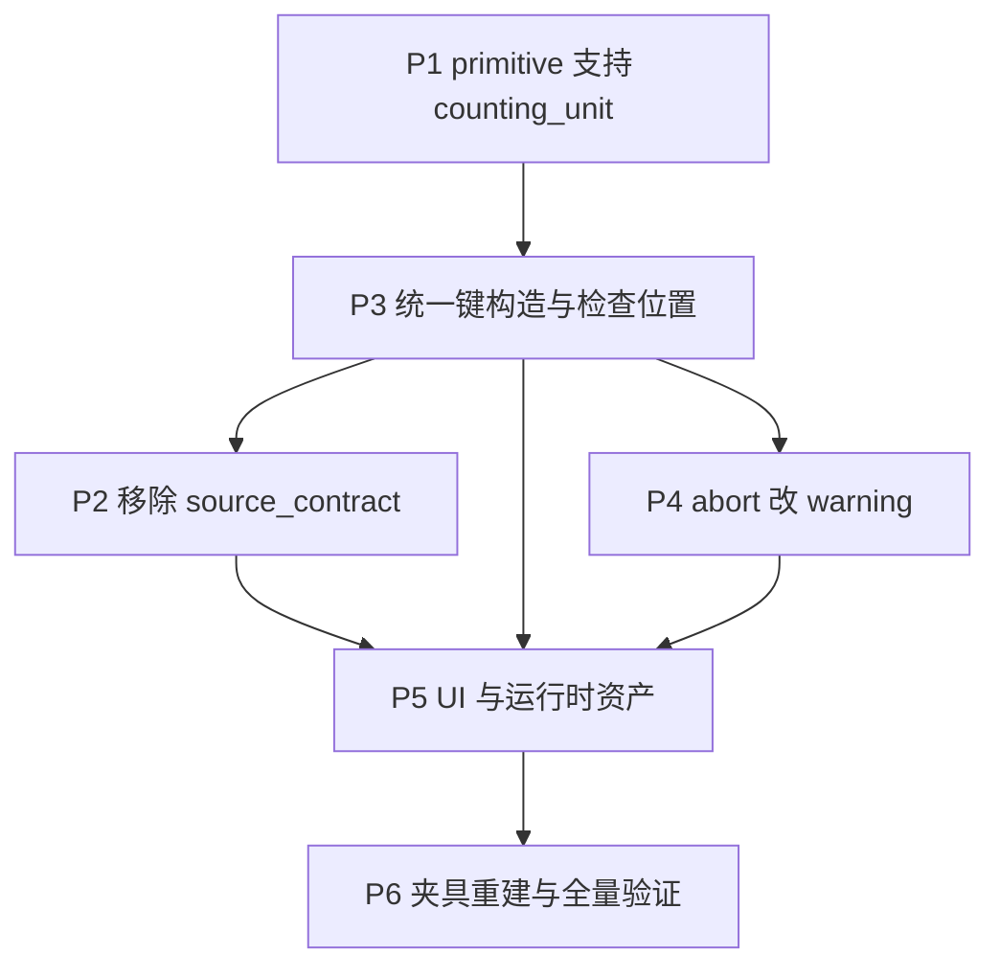

# 计划：统一 counting_unit 与重构重复检查/去重

状态：设计已确认（2026-10-25）；待实施。前置提交 `f66ead1`（revert 了
`89212a3` 与 `b602244`）。

本计划取代被 revert 的自动去重功能。原实现在 source 层按
`source_contract.record_key` 去重，存在三个缺陷：

1. `record_key` 是「契约断言键」（`duplicate_policy: error` 的检查依据），
   被误用为删除键；
2. 去重发生在 hierarchical level discovery 之前，会改变层级节点集合；
3. 同一 chunk 下多个 analysis block 的 `counting_unit` 可能不同，单一
   source 层键无法同时满足。

本计划的核心结论：**去重能力早已存在**（`continuous_counting_unit_source` 的
counting-unit materialization 与 categorical 的 `nodupkey`），缺的不是去重，
而是「把重复检查下沉到与去重相同的层和键，并把冲突处理从 abort 改为 warning」。

## 1. 已确认的设计决策

| # | 决策 |
| --- | --- |
| D1 | `subject_key` 固定为 `USUBJID`，落在 `merge_contract$key`；emitter 直接使用常量 |
| D2 | 移除 chunk 级 `source_contract`（含 `grain`、`subject_key`、`record_key`、`duplicate_policy`） |
| D3 | 移除 registry 级 `source_contract`（零消费者，唯一校验是 `is.list()`） |
| D4 | `counting_unit` 扩展到所有 analysis chunk（primitive 也必填，与 hierarchical 同值域） |
| D5 | 重复检查下沉到 per-block 层，与去重使用同一键 |
| D6 | 所有重复报告每个键最多一次（避免日志爆炸） |
| D7 | `counting_unit: record` 既不生成重复检查，也不生成去重代码 |
| D8 | `continuous_unit_multiple_values` 由 `ABORT CANCEL` 改为 `WARNING`，保留输入顺序首条非缺失值 |
| D9 | primitive chunk 的 `denominator` 不新增 `unit` 字段（记录为 P-2a 待优化） |
| D10 | 迁移时所有既有 metadata 的 `counting_unit` 统一填 `distinct_subject` |

### D9 记录（待优化，本次不实施）

primitive chunk 的 `denominator` 缺少 `unit` 字段，分母恒按 `distinct_subject`
计数（`categorical.R:42,47` 的 `%||% "distinct_subject"` fallback），而
hierarchical 的 `denominator.unit` 是必填字段。影响：

- 顶层 primitive chunk 无法表达「按记录数作分母」；
- 同一 semantic 在两个宿主里配置方式不一致；
- `use_header_n` 判定（`source_generator.R:207-211`）依赖
  `unit == "distinct_subject"`，顶层 primitive 因无法设置 `unit` 而恒走该分支。

后续优化需明确：`denominator.unit` 在 primitive 是否必填；`counting_unit`（分子）
与 `denominator.unit`（分母）是否允许任意搭配；`use_header_n` 快捷路径在
`unit != distinct_subject` 时自动失效的行为是否保留。

## 2. 不变量

全程必须成立，每个阶段 gate 都检查：

| # | 不变量 |
| --- | --- |
| I1 | 引用完整性：同一身份变量在一处删除必须同时在解析、registry、YAML、UI 清除 |
| I2 | 计数单位来源唯一：仅 `counting_unit`；`distinct_key` 仅当 `counting_unit == "distinct_key"` 时存在 |
| I3 | 主题键固定 `"USUBJID"`，消费者使用常量而非可配置字段 |
| I4 | 已声明单位类型下至多生成一个唯一性 guard，且每个重复键最多报一次 |
| I5 | `record` 不生成 guard，也不生成去重代码（键 `source_row` 恒唯一） |
| I6 | `continuous_unit_multiple_values` 不再中止提交 |
| I7 | 不引入运行期数据读取或 SAS 执行；仍只输出 source text |
| I8 | 阶段 gate：`Rscript test/run_tests.R` exit=0 且 `git diff --check` 干净 |

### 键构造规则（P3 的统一目标）

**去重键 = 位置维度 + `counting_unit` 键**

| 宿主 | 位置维度 | 生成位置 |
| --- | --- | --- |
| 顶层 primitive | `chunk_order` | merge 前（无 `node_key`/`column_order`） |
| hierarchical nested | `chunk_order` + `node_key` | `_TFL_HMERGE_*` 之后 |
| 分析期 materialization | `chunk_order` + `column_order` + `node_key` | 保持现状 |

per-block 重复检查**刻意不含 `column_order`**：membership 展开会把一条源记录
广播到 N 个表头列，若含 `column_order`，同一重复会报 N 次，违反 I4。分析期
materialization 仍保留 `column_order`，因为那是按单元格折叠。

## 3. 依赖 DAG



P1 为纯新增；**P3 必须先于 P2**（见下方修订记录）；P2 在 P3 之后才成为纯删除；
**P4 是唯一改变统计语义的阶段**，也是唯一需要人工复核 SAS 输出的阶段。

### 修订记录（2026-10-27）：P2 与 P3 顺序调换

原计划假定 P2（移除 `source_contract`）是纯删除，并以「P2 前后生成的 SAS 逐字节
一致」作为验收。实施 P2 时发现该前提不成立：

1. `record_key` 并非零消费者。它直接进入 `hierarchical.R:472` 的 source 层
   duplicate guard 的 BY 子句和 `unit=` 诊断标签。基线证据：
   `vitals_by_visit` 生成 `by USUBJID PARAMCD AVISITN`，`ae_by_soc_pt` 生成
   `by USUBJID AESEQ`。
2. 先删 `record_key` 会让 source 层 guard 失去键，P2 与 P3 因此存在隐藏耦合。
3. `record_key` 无法由 level 推导：`ae` 的 `AESEQ` 不出现在任何 level 的
   `variable` 或 `order_variable` 中。

改为先执行 P3（per-block 检查与去重同键落地、移除 source 层检查），再执行 P2；
此时 source 层 guard 已不存在，P2 才真正是纯删除。阶段编号保留原值以避免与本
文件其他段落及提交信息冲突，执行顺序以本 DAG 为准。

## 4. 各阶段

### P1：primitive chunk 支持 `counting_unit` / `distinct_key`

**目的**：primitive 具备与 hierarchical 相同的计数单位声明能力（D4，必填）。

**改动**

| 文件 | 改动 |
| --- | --- |
| `src/chunks/registry.R` | `make_primitive_definition()` 的 `required_fields` 追加 `"counting_unit"`，`optional_fields` 追加 `"distinct_key"`；`field_types` 追加对应项 |
| `src/chunks/registry.R` | 三个 primitive 定义（continuous、nonexclusive、exclusive）同步 |
| `src/metadata/model.R` | 从 hierarchical 提取 `parse_counting_unit_value()`、`parse_distinct_key_value()`、`validate_counting_unit_pair()`，两处共用 |
| `src/metadata/model.R` | `parse_chunk_value()` 的 primitive 分支解析并写入 `result` |
| `src/metadata/yaml_codec.R` | `render_chunk_yaml()` 在 `filter` 之后输出 `counting_unit`，非空时输出 `distinct_key` |
| `src/generator/source_generator.R` | `chunk_batch_signature()` 对 `continuous_summary` 也加入 `chunk_key_contract`（现仅 categorical），否则不同 `counting_unit` 的同源 continuous chunk 会错误合批 |

**必须补齐的数据**（因为改为必填，D10 统一填 `distinct_subject`）

`assets/build_demo_bundle.R`、`test/testthat/test-workspace.R`、
`test/testthat/test-yaml-codec.R`、`test/testthat/test-z-hierarchical-emitter.R`、
`test/fixtures/sas/hierarchical_row_assembly/metadata.R`。

**验收**

- YAML round-trip：三种 `counting_unit` × `distinct_key` 有无
- 新增 `test/testthat/test-counting-unit-contract.R`：
  `counting_unit` 缺失 → `bundle_required_field_missing`；非法值 → `bundle_value_invalid`；
  `distinct_key` 配非 `distinct_key` unit → `bundle_value_invalid`；
  `counting_unit: distinct_key` 缺 `distinct_key` → `bundle_required_field_missing`
- 现有测试全绿；`assets/demo_metadata.zip` 可重建并通过 round-trip

### P2：移除 source_contract 三层定义

**目的**：删除零消费者字段，`subject_key` 固定 `USUBJID`（D1、D2、D3、I3）。

**改动**

| 文件 | 改动 |
| --- | --- |
| `src/chunks/registry.R` | 删 `new_chunk_type_definition()` 的 `source_contract` 参数、`is.list()` 校验、字段赋值；删 primitive 与 hierarchical 定义中的 `source_contract` |
| `src/metadata/model.R` | 删 `parse_source_contract_value()`；`parse_hierarchical_chunk_value()` 不再解析与回填 `source_contract` |
| `src/metadata/yaml_codec.R` | 删 `render_source_contract_yaml()` 及其 emit |
| `src/emitters/hierarchical.R` | nested plan 的 `subject_key`、membership 的 `source_contract$subject_key`、compatibility 的 `source_contract`、`keys` 计算、exists 过滤全部改为常量 `"USUBJID"`。**前置条件**：P3 已删除 source 层 guard，因此这里的 `keys` 计算可整体移除 |
| `src/ui/metadata_editor_helpers.R` | 删默认 chunk 的 `source_contract` |
| `src/ui/metadata_editor_runtime.R` | 删 `source_contract` 读写 |
| `src/ui/metadata_editor_template.R` | 删 grain/subject_key/duplicate_policy/record_key 输入 |

**验收**

- `grep -rn "source_contract\|duplicate_policy\|record_key" src/` 无输出
- **快照比对**：P3 提交后先保存全部 demo table 的生成结果，P2 后逐字节比对，
  证明 P2 是纯删除
- 全绿

**为什么换成 P3 先执行**：P1 gate 时保存的基线无法用作 P2 的比对基准，因为
`record_key` 驱动 source 层 guard 的 BY 子句（详见第 3 节修订记录）。

**实际落地情况（已实施）**

- 新增 `subject_key_constant()`（`source_input.R`），取代 `plan$subject_key` 与
  `chunk$source_contract$subject_key` 两种取法；实测 `plan$subject_key` 从未
  被赋值，一直走 fallback
- `hierarchical_nested_plan()` 的 `subject_key`、`hierarchical_membership_source()`
  的 rename、`hierarchical_source_dataset` 的 exists 过滤均改为常量
- compatibility 判等中的 `source_contract` 字段整体删除
- registry：`new_chunk_type_definition()` 的 `source_contract` 参数、`is.list()`
  校验、字段赋值，以及两种 chunk 定义中的 `source_contract` 全部删除
- `correctness_guards` 中的 `duplicate_record_key` 一并删除（P3 后已无对应实现）
- UI：`source_contract` 默认值、读写逻辑与 Source contract 面板（grain /
  subject_key / duplicate_policy / record_key 四个输入）全部删除
- demo bundle 重建，md5 由 `e28f2512f77d0f2ad4d037d346dee332` 变为
  `00e1d3c039c04280c0db22ffc45a81ce`（5468 字节）
- SAS 夹具 `build_sources.R`/`metadata.R` 中的 `source_contract` 参数同步删除

### P3：统一键构造与移除 source 层检查

**目的**：键构造在两级宿主一致（D5、I2、I4、I5）。

**改动**

| 文件 | 改动 |
| --- | --- |
| `src/emitters/source_input.R` | `primitive_counting_keys()` 的 `record` 返回 `character()`（表示无去重键）；`primitive_source_input()` 的 source 层 guard 删除 |
| `src/emitters/source_input.R` | 新增基于位置键 + 单位键的 block guard，复用现有 `if last.<key>` 单次报告结构 |
| `src/emitters/continuous.R` | 删 source 层 guard；`subject_key` 改常量；`continuous_counting_unit_source()` 顶部接入 per-block 检查 |
| `src/emitters/categorical.R` | 删 `_TFL_KKEY_*` 与 source 层 guard；在 `_TFL_KIN_*` 合成后、`nodupkey` 前插入 per-block 检查；`subject_key` 改常量 |
| `src/emitters/hierarchical.R` | 删 source 层 guard。`keys` 在 P3 中已不再被使用，可一并移除；`record_key` 字段本身在 P2 才删除 |

**验收**

- 新增 `test/testthat/test-block-duplicate-guard.R`：三种 unit × 两宿主，断言
  guard 存在性与 BY 键序列
- `record` 时断言源层 key 表与 block guard 均不出现
- categorical/continuous 的 guard BY 键与 hierarchical 同 unit 情形逐项一致

**实际落地情况（已实施）**

- `source_input.R`：新增 `source_block_duplicate_guard()`，`record` 时直接返回
  `character()`，因此无需调用方分支
- `source_input.R`：`primitive_source_input()` 的 source 层 guard 删除；
  `plan$subject_key` 保留至 P2
- `categorical.R`：`_TFL_KKEY_*` 数据集与 `categorical_chunk_key_dataset()` 一并
  删除（删 guard 后它们无消费者）；per-block 检查插在
  `/* Count declared units ... */` 之下的 `_TFL_KIN_*` 上
- `continuous.R`：per-block 检查插在 `continuous_counting_unit_source()` 里，落在
  `plan$input_dataset`（`_TFL_CIN_*`）上；`record` 默认值由 `"record"` 改为
  `"distinct_subject"`，与 `primitive_counting_keys()` 保持一致
- `hierarchical.R`：source 层 guard 与已死的 `keys` 变量删除；`record_key`
  字段保留至 P2

实测 demo bundle 的 guard 位置（`include_duplicate_check = TRUE`）：

| table | guard 数据集 | BY 键 |
| --- | --- | --- |
| `ae_by_soc_pt` | `_TFL_KIN_002` | `chunk_order node_key USUBJID` |
| `baseline_characteristics` | `_TFL_CIN_001` | `chunk_order USUBJID` |
| `baseline_characteristics` | `_TFL_KIN_002` | `chunk_order USUBJID` |
| `z_ae_overview` | `_TFL_KIN_001` | `chunk_order USUBJID` |
| `vitals_by_visit` | 无（`record`） | — |
| `z_lab_change_over_time` | 无（`record`） | — |

### P4：`abort cancel` 改为 `WARNING`

**目的**：I6、D8。唯一改变统计语义的阶段。

**改动**

`src/emitters/continuous.R` 的 `continuous_counting_unit_source()`：
`if _tfl_nonmissing_count > 1` 分支内删除 `abort cancel`，`putlog` 级别由
`ERROR` 改为 `WARNING`。每个单元只报一次由 `if last.<key>` 天然保证。

**同步**

`docs/design-decisions.md`（统计契约、P0-13、P0-14 三处）、
`table-and-chunk-analysis-model.md`、`test/testthat/test-z-hierarchical-emitter.R`
（断言 `WARNING` 且断言不出现 `abort cancel`）、
`test/fixtures/sas/continuous_counting_units/README.md` 与
`run_distinct_subject_conflict.sas`（原夹具专门测 abort，需重新定义预期）、
`test/fixtures/sas/hierarchical_continuous_batching/README.md`。

**验收**

- `grep -rn "abort cancel" src/emitters/continuous.R` 无输出
- 断言 `distinct_subject` 且多值时生成一个 `WARNING`，`analysis_value` 取
  `source_row` 最小者
- **人工复核** `vitals_by_visit` 生成的 `PROC MEANS` 前置段

### P5：UI 与运行时资产

**改动**

| 文件 | 改动 |
| --- | --- |
| `src/ui/metadata_editor_template.R` | primitive chunk 区域新增 `counting_unit` selectInput 与 `distinct_key` textInput |
| `src/ui/metadata_editor_runtime.R` | 抽取共享的 counting-unit 收集函数，primitive 与 block 共用 |
| `src/ui/metadata_editor_helpers.R` | 新建 primitive chunk 默认补 `counting_unit = "distinct_subject"` |
| `assets/build_demo_bundle.R` | 重建 `assets/demo_metadata.zip` |
| `assets/user-guide.md` / `user-guide.zh-CN.md` | 新增「计数单位」章节：三值语义、`record` 不检查不去重、`distinct_key` 用法、旧 bundle 迁移步骤 |
| `docs/open-questions.md` | 记录 P-2a |

**验收**

- shinytest2 全绿，新增 primitive chunk 编辑断言
- demo bundle 导入 → 生成 → 导出 round-trip
- 手工走查 UI：分别编辑 hierarchical 与 primitive 的 `counting_unit` 并各生成一次 SAS

### P6：夹具重建与全量验证

**改动**

- 重跑 `test/fixtures/sas/*/build_sources.R` 重新生成 `generated/*.sas`
- P4 后冲突场景不再 abort，`continuous_counting_units/*.rtf` 与 `assertions.sas` 期望重算
- `docs/design-decisions.md:168` 与 `table-and-chunk-analysis-model.md:699,734`
  的 grain/record_key/duplicate_policy 章节改写为「已移除」

**验收**

- `Rscript test/run_tests.R` exit=0（连续 3 次）
- `git diff --check` 干净
- `grep -rn "source_contract" src/ test/ assets/` 无输出

## 5. 回归风险与对策

| 风险 | 等级 | 对策 |
| --- | --- | --- |
| D4/D10 破坏性变更：旧 bundle 导入失败 | 高 | 错误消息明确指向缺失字段；user-guide 写迁移步骤；demo bundle 同步更新 |
| `distinct_subject` 的 continuous block 频繁 warning | 高 | P4 gate 人工复核；user-guide 说明「保留输入顺序首条」不等于「去重」 |
| per-block 检查扫 `_TFL_HMERGE_*`，行数放大 | 中 | 检查放在 `nodupkey` 前，只按位置键 + 单位键排序；不含 `column_order` |
| `continuous` 合批签名变更导致批次划分变化 | 中 | P1 独立提交，用现有批次断言验证 |
| P2 的逐字节快照过严 | 低 | 若仅格式化差异，降级为关键语句集合比对 |

## 6. 提交与回滚

- 每阶段一个提交，P1 → P6 顺序，禁止跨阶段合并
- P1、P2 可独立 revert；P3、P4 涉及生成源码变更，提交信息须注明
- 若 P4 出现问题，revert 即回到 P3 的 abort 语义，不影响 P1–P3

## 7. 验证命令

```bash
Rscript test/run_tests.R
git diff --check
grep -rn "source_contract\|duplicate_policy\|record_key" src/
grep -rn "abort cancel" src/emitters/
Rscript test/fixtures/sas/continuous_counting_units/build_sources.R
```

## 8. 完成核验清单

实施完成后逐项勾选，用于验收：

- [x] P1：primitive 三种类型均要求 `counting_unit`；`distinct_key` 校验与 hierarchical 一致
- [x] P1：`continuous_summary` 参与 `chunk_batch_signature` 的 key contract
- [x] P1：新增 `test-counting-unit-contract.R` 覆盖四种错误组合
- [x] P3：`record` 不生成任何 guard 或去重代码
- [x] P3：categorical/continuous 的 guard BY 键与 hierarchical 同 unit 一致
- [x] P3：per-block 检查不含 `column_order`
- [x] P3：source 层 guard 完全移除（`_TFL_GKEY_*`、`_TFL_GUARD_H*`、`_TFL_KKEY_*` 不再生成）
- [x] P2：`src/` 中 `source_contract`、`duplicate_policy`、`record_key` 零出现
- [x] P2：P3→P2 生成的 SAS 逐字节一致
- [x] P4：`continuous.R` 中无 `abort cancel`
- [x] P4：多值场景生成 `WARNING` 且只报一次，取值来自最小 `source_row`
- [x] P5：UI 可编辑 primitive 的 `counting_unit` / `distinct_key`
- [x] P5：demo bundle 重建，两版 user-guide 同步
- [x] P5：`docs/open-questions.md` 记录 P-2a
- [x] P6：全部 SAS 夹具重新生成
- [x] P6：`Rscript test/run_tests.R` 连续 3 次 exit=0
- [x] P6：`git diff --check` 干净

## 9. 完成后审查（2026-10-27）

P1-P6 完成后对 `ea9a83d..fbf5fe5` 做独立审查，发现 5 个问题并全部修复。

### 引入归属

| # | 问题 | 归属 |
| --- | --- | --- |
| 1 | 顶层 continuous guard 引用已丢弃的 `USUBJID` | 本次引入（P3 把 guard 移到 merge 后的窄表） |
| 2 | `record` 空键使 NODUPKEY 压缩全表；exclusive 生成 `if first. then` | 本次引入退化（NODUPKEY 是既存的，原 `record = "source_row"` 恰好安全） |
| 3 | 顶层 continuous 跳过 counting-unit materialization | 既存缺陷（`1b9b5eb` 即如此） |
| 4 | categorical membership merge 丢弃 `distinct_key` 变量 | 既存缺陷 |
| 5 | guard 在已展开事件表上检查，把展开副本报成重复 | 本次引入（P3 选错位置） |

### 根因

`primitive_counting_keys()` 同时承担「记录身份键」与「是否检查」，`record` 返回
`character()` 把二者塌缩成一个返回值。所有无条件消费该键的调用点因此静默失效。

### 修复

- 拆分为 `primitive_counting_keys()`（身份键，`record` 恒为 `source_row`）与
  `primitive_check_keys()`（检查键，`record` 为空）。NODUPKEY 恢复正确性，
  同时 `record` 仍不生成检查。
- guard 移到**展开前**的真实源记录层，粒度为 per-chunk：categorical 用
  轻量投影 `_TFL_KSRC_<batch>_<chunk>`（只保留位置键与检查键），continuous 直接
  读 `_TFL_CIN_*`。nested 时位置键含 `node_key`。
- 顶层 continuous 不再跳过 materialization，`distinct_subject`/`distinct_key` 真正
  生效；chunk 输入与 merge 输出保留 `USUBJID` 与自定义键。
- categorical membership merge 的 select 与 keep 动态带上 `distinct_key` 变量。

### 预期输出变化

P6 之后与 P2 之后的 demo 输出有 4 个文件不同，均为预期：

- `baseline_characteristics.nocheck/check`：新增 `_TFL_CUNIT_001` materialization，
  `PROC MEANS` 输入由 `_TFL_CIN_001` 改为 `_TFL_CUNIT_001`（问题 3）。
- `ae_by_soc_pt.check`、`z_ae_overview.check`：guard 数据集与编号由
  `_TFL_GUARD_K###`(展开后) 改为 `_TFL_GUARD_###_###`(源记录层)（问题 5）。

### 新增回归测试

`test/testthat/test-block-duplicate-guard.R` 末尾追加 6 个用例，断言
「guard 的每个 BY 变量都被其输入数据集 keep」而非仅断言语句出现，另覆盖
`record` 不压缩记录、exclusive 无空键、顶层 continuous 走 `_TFL_CUNIT_*`、
`distinct_key` 变量贯通、guard 读 `_TFL_KSRC_*` 且不含 `column_order`。

### 保留的设计取舍

- **D7** 成立但需明确：`source_row` 唯一只证明物理行身份唯一，不证明业务键
  （如 `USUBJID AESEQ`）完整。移除原检查后该责任完全交给调用方。需要该检查时
  应声明 `counting_unit: distinct_key`，其语义是去重而非仅报错。
- **D8/P4** 成立但结果依赖输入顺序，已在两版 user-guide 补充说明；冲突夹具断言
  的仍是「继续执行」而非实际保留值与统计量，这属于 SAS 侧运行期验证，不在本应用
  边界内。

## 10. 第二轮审查（2026-10-27）

第二轮外部审查报告 2 个 P1 与 1 个测试缺陷。三条全部复现确认后修复
（提交 `b882cc8` 之后的 `Guard both membership union branches and nested chunk positions`）。

### 问题归属

| 编号 | 问题 | 归属 |
|---|---|---|
| P1-a | `categorical.R` 事件侧 SELECT 增加自定义键，scaffold 侧未同步，UNION 两侧列数不一致 | 本次 `b882cc8` 引入（只改了一侧） |
| P1-b | nested continuous guard 对 level 表 `by chunk_order`，但该表从未生成 `chunk_order` | 本次 `b882cc8` 引入（改输入未补字段） |
| P2 | 新增 nested 回归测试实际被 skip，且 feeder 正则匹配不到 | 本次引入（路径用相对 `assets/`） |

### 根因

- **P1-a**：`categorical_batch_source_input()` 用 `union all` 合并「事件行」与
  「header_population 占位行」。`extra_keys`（来自 `primitive_counting_keys()`）
  只加进事件分支。SQL 的 `UNION ALL` 要求两侧列数、顺序、类型一致，因此该批次
  在 `proc sql` 阶段必然失败。它与 `include_duplicate_check` 无关，是两条分支
  不对称导致的。
- **P1-b**：`_TFL_HLEVEL_*` 由 `data _TFL_HLEVEL_* _TFL_HNODES_*; set _TFL_HSORT_*;`
  生成，全程不赋 `chunk_order`；`chunk_order` 只在后续 `_TFL_CIN_*` 里赋值。
  guard 直接排序 level 表，于是 `by chunk_order` 引用不存在的变量。上一轮把
  guard 输入从 `HMERGE`（已按列广播）改为 `HLEVEL`（正确粒度）时，漏了「正确的
  粒度但不含位置字段」这一点。
- **P2**：`testthat::test_path()` 的相对基准是 `test/testthat`，因此
  `file.path("assets", ...)` 永远找不到根目录的 bundle，`skip_if_not()` 静默
  跳过。feeder 正则假设 guard 输入由 `set <guarded>` 直接喂入，但修复后它由
  DATA step 构造，断言条件与实现不匹配。

### 修复

1. `categorical.R`：scaffold 分支新增
   `left join <pre> as t on 0 = 1` 并投影 `t.<key>`。用永不匹配的连接从事件侧
   取键，而不是写 `'' as VISIT` 字面量，因此两侧列的类型也一致，无需人工推断
   每个键的 SAS 类型。
2. `continuous.R`：新增 `continuous_guard_source_dataset()` 与一个 DATA step，
   在 level 表上显式 `chunk_order = <plan$chunk_orders[[1L]]>` 并 `keep` 位置键
   与检查键，再交给 `source_block_duplicate_guard()`。
3. `test-block-duplicate-guard.R`：改用 `file.path(project_root, "assets", ...)`；
   新增 3 个用例——UNION 两侧列数与键一致、nested continuous guard 构造
   `chunk_order` 且 BY 变量都在 guard 输入的 keep 里、nested `record` 不产生 guard。

### 反向验证

两条回归测试都做了「先回退修复、确认测试失败、再恢复」的验证：

- 移除 scaffold 的 `t.<key>` 投影与 `left join` → `declared keys reach both
  branches` 用例 3 条断言失败。
- 移除 nested continuous 的 `chunk_order` 赋值 DATA step → `nested continuous
  guards construct the chunk position field` 用例 4 条断言失败。

### 保留的设计取舍

- **UNION 类型一致性**用 `on 0 = 1` 的连接实现，而不是在 scaffold 分支手写
  类型化字面量。代价是执行计划里多一个空连接；收益是新增 `distinct_key` 时不
  需要维护第二份类型映射。
- **nested guard 的位置字段**在 guard 输入里构造，而不是让 level 表本身带
  `chunk_order`。后者会污染层级表的语义，并让渲染阶段继续依赖一个与节点无关
  的批内序号。
