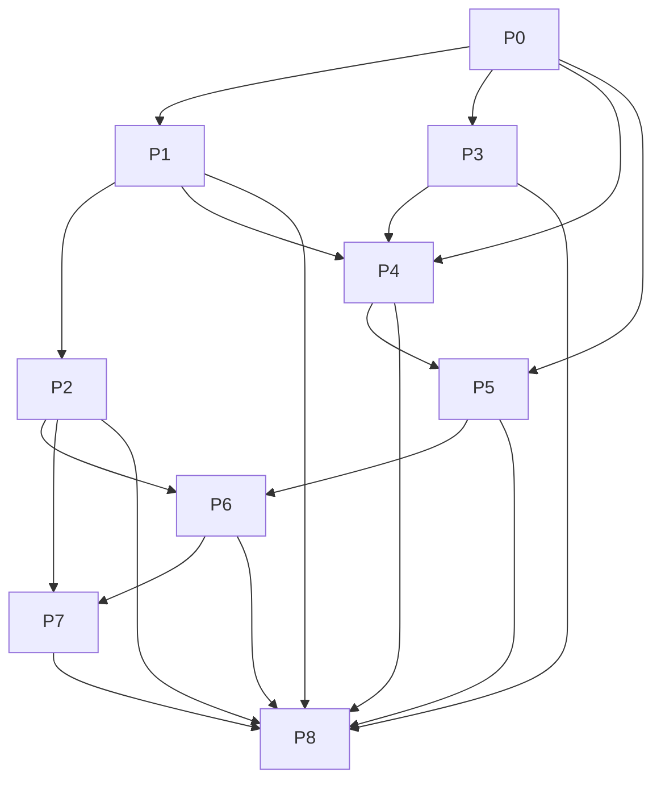

# SAS Code Generation 实施计划

状态：阶段划分已确认；详细计划 v1（2026-09-02）。P0-1 工具链与 YAML 解析
边界已于 2026-09-03 确认，P0 仍在进行中。

本计划基于 `table-and-chunk-analysis-model.md`、`docs/design-decisions.md` 和
`docs/ref-alignment.md`。它只描述实现阶段、输入、产物、验收和依赖关系；在
前置阶段完成并通过 gate 之前，不实现依赖该阶段的业务功能。

## 1. 固定边界

- 产品只生成 SAS source text，不读取或上传 SAS 分析数据，不执行 SAS，不生成
  R/RTF/PDF/HTML/ODS/PROC REPORT 或运行结果。
- metadata 采用单文件 canonical YAML；core 只处理内存值和显式 bytes，不依赖
  固定 metadata 路径。
- 每个 Shiny session 独占一个 `MetadataWorkspace`；core 不接收 Shiny session、
  input/output、上传临时路径或下载路径。
- ref 只提供字段和业务语义参考；R data frame、R expression、R runtime、study
  roots、Rscript 和 reporter 不迁移到本项目。
- 所有 production code、test code、generated SAS、机器诊断和 code comments 使用
  English；规划和设计文档可以使用中文。
- generated source、导出 bundle、缓存、日志和临时文件不进入 Git。

## 2. 依赖 DAG

阶段依赖只指向明确的前置产物，不依赖后续代码或占位实现。



完整边集合：

```text
P0 -> P1, P3, P4, P5
P1 -> P2, P4
P3 -> P4
P4 -> P5
P2 -> P6
P5 -> P6
P2 -> P7
P6 -> P7
P1, P2, P3, P4, P5, P6, P7 -> P8
```

P1 与 P3 在 P0 完成后可以并行；P2 不依赖 generator；P4 不依赖 workspace
service；P7 不向任何 core 阶段提供输入，因此不会形成环。

## 3. 阶段总览

| 阶段 | 名称 | 依赖 | 主要交付物 |
| --- | --- | --- | --- |
| P0 | 实施基线与剩余实现级契约锁定 | 设计文档 | 依赖锁定、emitter 微契约、测试基线 |
| P1 | Metadata 对象、canonical YAML 与结构错误 | P0 | value model、YAML codec、结构错误和 round-trip tests |
| P2 | Workspace、draft 与 revision | P1 | session-owned state service、CRUD、draft tests |
| P3 | Chunk registry 与类型契约 | P0 | `ChunkTypeDefinition`、字段规则、registry tests |
| P4 | SAS source generator 核心 | P0、P1、P3 | source sections、reference resolution、operation comments、generation errors |
| P5 | SAS emitter 与分析/render 实现 | P0、P3、P4 | 四类 emitter、precision/formatting source tests |
| P6 | UI 无关的 application orchestration | P2、P4、P5 | import/export/generate service、显式 value-object boundary |
| P7 | Shiny UI 与 `app.R` | P2、P6 | ViewState、编辑器、dirty guard、preview/download |
| P8 | 集成验证、交付与维护文档 | P1-P7 | end-to-end tests、验收记录、最终文档和 clean handoff |

## 4. 各阶段计划

### P0：实施基线与剩余实现级契约锁定

**目标**：把仍属于实现选择、但会影响多个后续阶段的内容先冻结。P0 是决策和
工具链 gate，不实现业务功能。

**输入**：第 1-9 组已确认设计、canonical YAML 规则、ref 对齐审查、当前
`AGENTS.md` 和空的 `src/`/`test/` 目录。

**必须产出**：

- R 版本、YAML parser 包和版本、测试框架及依赖锁定策略；
- `source_data` 非空字符串的结构边界和原样插入规则；
- code-owned registry interface、四类 type discriminator set 和 registry extension
  boundary；
- 四类 emitter 的具体 SAS PROC/DATA step、临时对象生命周期和 logical output
  映射；
- `cell_format`、`PROC MEANS`/`PROC FREQ`、base digits、`ROUND`/`PUTN`、missing/`NE`
  的 SAS 微契约；
- synthetic fixture 规则、测试命令和 generated-output 排除规则；
- 对应的设计决策补充和 open-question 清理。

**约束**：不得根据 ref 的 R 实现自动推断上述 SAS 选择；未获确认的实现级选择
必须保留为 gate，不能由后续代码隐式决定。

**验收**：依赖可安装且可锁定；每项实现级选择有唯一记录；没有 production
business code；`git diff --check` 通过。

**当前进度**：P0-1（R/YAML 工具链与严格解析边界）、P0-2（canonical YAML
数值序列化）、P0-3（source_data 与关键操作注释）以及 P0-4 的 PROC、内部长表和
数值格式化选择已确认；运行期数据契约失败的中止方式仍未确认。

### P1：Metadata 对象、canonical YAML 与结构错误

**依赖**：P0 的 parser/toolchain 和错误微契约。

**输入**：P0 的 canonical profile、对象字段契约和第 8 组 `ErrorItem`。

**必须产出**：

- 普通 R list value model，覆盖 bundle、population、header、table、template、
  chunk、row、level、analysis block 和 statistic；
- strict single-document YAML decoder/encoder；导入允许有效 UTF-8 的 BOM/CRLF，
  导出固定 UTF-8、无 BOM、LF、两空格和字段顺序；
- unknown field、duplicate key、unsupported YAML feature、schema/version、ID、
  discriminator 和 required-field 的结构错误；registry-dependent type checks use the
  P0 discriminator/interface contract；跨对象引用继续允许延迟；
- `BundleImportResult`、`ErrorItem` 和稳定 path/error ordering；
- canonical bytes value object，供稳定导出使用；不计算或保存 metadata hash。

**不做**：不读取 SAS 数据，不执行表达式，不解析 custom code，不实现 workspace
替换，不检查跨对象引用是否存在。

**测试**：valid bundle round trip、canonical byte stability、BOM/CRLF normalization、
invalid UTF-8/YAML、multi-document、duplicate key、anchor/tag/merge key、unknown
field、missing/duplicate ID、discriminator/type-shape errors、stable multi-error ordering。

**完成 gate**：同一结构输入产生相同 value、canonical bytes 和错误顺序；失败不会
产生部分 candidate value。

### P2：Workspace、draft 与 revision

**依赖**：P1 的 value model、结构错误和 serialization boundary。

**输入**：P1 的 parsed value、P0 的 registry interface contract、`BundleImportResult`、
第 3/9 组 workspace contract。

**必须产出**：

- session-owned `MetadataWorkspace` 生命周期和空 workspace 初始化；
- population/header/table/template 及嵌套 chunk、level、block、row 的 CRUD、顺序
  移动和 position-ID 重编号；
- active draft 的 base value、draft value、dirty 状态和
  `draft_base_revision`；
- `saved_revision` 的 Import/Save/Discard/Cancel 转移；
- Save 的 strict structural gate、引用可延迟、删除影响检查和方案 A 删除规则；
- import candidate 的原子应用以及失败时只更新 `parse_diagnostic` 的边界。

**不做**：不生成 SAS、不读取数据、不接触 Shiny reactive object、不创建文件。

**测试**：draft commit/rollback、revision transitions、dirty state、import atomic
replace、parse diagnostic preservation、save structural errors、deletion impact、
position-ID/reference synchronization、export uses saved snapshot only。

**完成 gate**：所有状态转移都是显式且可重复的；失败操作不改变已保存 metadata；
workspace API 可以在无 Shiny 环境下运行。

### P3：Chunk registry 与类型契约

**依赖**：P0 的 emitter 微契约、registry interface 和已确认的 chunk/row/statistic
字段契约。

**输入**：四类 chunk 的已确认业务边界、type discriminator、类型专属字段和
row/statistic contract。

**必须产出**：

- code-owned `ChunkTypeDefinition` registry；
- primitive/container capability、allowed/required fields、data grain、filter/merge、
  analysis/render 和 source-emitter contract；
- 四类类型的 metadata shape rules；hierarchical 对 primitive registry 的调用边界；
- registry lookup、unknown type 和 unavailable emitter 的稳定 host-side errors；
- registry 测试夹具和最小 mock emitter。

**不做**：不把 handler、PROC 或临时 dataset 名写入 YAML；不执行 SAS；不读取数据。

**测试**：known/unknown type、missing required fields、unknown type-specific fields、
discriminator mismatch、duplicate statistic ID、placeholder mismatch、registry
determinism、container-to-primitive dispatch。

**完成 gate**：新增类型只需注册新的 code-owned definition；公共 generator 不需要
type switch；registry contract 可被 P4/P5 消费，不依赖 YAML codec 的内部实现。

### P4：SAS source generator 核心

**依赖**：P0 的 source_data/operation-comment 约定，P1 的 parsed snapshot 和 errors，
P3 的 registry。

**输入**：已保存 snapshot、目标 `table_id` 和 registry/emitters。

**必须产出**：

- `GenerationRequest` 和 host-side `ResolvedTableInput`；
- table population/header/template 引用解析和确定性 prerequisite error collection；
- `SourceSection` assembly，固定 executable 顺序和 section ownership；
- `source_data` 原样插入以及 custom before/after 原样插入；
- population、header membership、chunk filter/merge、analysis 和 table render/assembly
  的确定性 English operation comments；
- 不返回 partial source 的 generation failure boundary；
- 使用 mock emitter 的 source regression tests。

**不做**：不执行 SAS、不读取路径或数据、不验证 expression/custom code、不写 `.sas`
文件；具体 chunk 统计由 P5 提供。

**测试**：section order、custom-code placement、source_data passthrough including macro
text、reference errors、missing emitter、deterministic operation comments、absence of
binding/provenance metadata、no partial source on failure。

**完成 gate**：相同 snapshot、registry 和 generator contract 产生相同 source；P4 可用
mock emitter 完成完整 source assembly。

### P5：SAS emitter 与分析/render 实现

**依赖**：P0 的 SAS 微契约，P3 的 registry，P4 的 generator/emitter interface。

**输入**：四类 chunk metadata、scaffold contract 和 P4 source assembly boundary。

**必须产出**：

- `continuous_summary` 的 source emitter、analysis/raw statistic 和 render/cell
  formatting；
- `categorical_summary_nonexclusive` 的 denominator、numerator、n/pct 和 render；
- `categorical_summary_exclusive` 的 explicit counting-unit overlap guard；
- `hierarchical_summary` 的 level/group discovery、ordering、nested primitive
  dispatch、row flattening 和 result sort；
- filter-before-merge、subject/record/observation grain、cardinality 和 scaffold
  相关 SAS source；
- relative digits、15 significant digits、sample SD、`PROC MEANS` 默认 percentile、
  `ROUND`/`PUTN` fixed digits、trailing zero、negative zero 和 `NE` 的 source
  implementation；
- 每类 emitter 的 source regression fixtures。

**不做**：不执行生成的 SAS，不保存 runtime result，不产生 report artifact；不由
emitter 通过未声明的 shared mutation 传递状态。

**测试**：每类 source structure、section ownership、row/column identity、relative
digits boundaries、n=0/1、non-finite handling、denominator zero/`NE`、exclusive
overlap guard、hierarchical order and dynamic-node rules，以及 mixed-template
assembly source tests。

**完成 gate**：P4 可以通过 registry 调用所有已纳入首期的 emitter；输出满足第
2、5、6、7 组的业务语义；不需要 SAS runtime 才能完成 host-side regression。

### P6：UI 无关的 application orchestration

**依赖**：P2 的 workspace/draft service，P4 的 generator，P5 的 emitters。

**输入**：raw bundle bytes、workspace state、saved snapshot 和 table ID。

**必须产出**：

- import application flow：bytes -> candidate -> atomic workspace apply；
- save/discard/export/generate 的 UI-neutral orchestration；
- generated source text 与关键操作 comments 的内存返回；
- 第 8 组错误在 import/workspace/generation boundary 的统一传递；
- 不含 Shiny、文件路径或 server session 的 service-level tests。

**不做**：不创建 `downloadHandler`，不读取 `input$*_file$datapath`，不写 bundle 或
SAS 文件，不管理 ViewState。

**测试**：same service used by import/export/generate callers、failure preservation、
dirty snapshot policy、generation gate、source-text handoff、error propagation and
deterministic output。

**完成 gate**：P6 可以在命令行或纯 R test process 中完成核心流程；所有 I/O 都被
显式 bytes/value boundary 包住。

### P7：Shiny UI 与 `app.R`

**依赖**：P2 的 workspace state 和 P6 的 application services。

**输入**：UI-neutral value objects、English error items、source text 和 download
payload contract。

**必须产出**：

- 薄 `app.R` 和 responsibility-based `src/` Shiny modules；
- session 初始化、`ViewState`、selected object/table、source preview 和通知状态；
- population/header/table/template/chunk editors；
- Import/Save/Discard/Cancel dirty guard；
- saved-snapshot metadata download、SAS preview 和 cleaned `{table_id}.sas` download；
- English user-facing labels and error presentation；
- UI tests using in-memory bytes and mock core results。

**不做**：不在 UI 重新解析 YAML/SAS expression，不实现第二套 validator/error model，
不直接访问 SAS 数据，不把 ViewState/revision 写入 bundle。

**完成 gate**：每个 session 的 workspace 隔离；dirty guard 和 saved-snapshot policy
可通过 UI 测试验证；UI 只通过 P6 application boundary 操作 core。

### P8：集成验证、交付与维护文档

**依赖**：P1-P7 的已通过 gate 产物。

**必须产出**：

- pure core 的全套 focused tests 与跨模块 integration tests；
- synthetic YAML bundle 到确定性 SAS source 的完整闭环测试；
- import failure、save failure、reference failure、emitter failure 和 dirty guard
  的 UI/core boundary tests；
- source section order、operation comments、relative precision 和 mixed chunks 的回归证据；
- README、运行/测试说明、`plans/` 维护说明和最终验收记录；
- Git 检查：`git status`、staged diff review、`git diff --check`、适用的 R test
  commands；generated outputs、cache、logs 和 local environment 均不提交。

**不做**：不引入 SAS execution、dataset fixtures、report artifacts、batch run 或
持久化 history。

**完成 gate**：所有批准范围的验收标准有自动化或明确的人工证据；工作区无意外
生成物；计划、设计决策和实现状态一致。

## 5. 变更与回滚规则

- 后续阶段发现前置契约不足时，先回到对应前置阶段更新文档和测试，再继续实现；
  不在下游用隐式兼容逻辑绕过 gate。
- 不改变已确认的 YAML 字段含义、relative precision、custom code 原样语义、
  source-only 边界或 UI/core ownership，除非用户重新确认并记录新决策。
- 每个阶段只提交与该阶段相关的设计、代码和 focused tests；不提交 generated
  source、上传内容、缓存、日志或机器路径。
- 任何失败操作都优先保持上一次已保存 workspace/source 状态；具体文件写入失败
  不扩大为未批准的 cross-file transaction。

## 6. 执行顺序

1. 完成 P0 的实现级选择和依赖锁定。
2. 并行实施 P1 与 P3；两者都通过 gate 后才能完成 P4 的输入闭合。
3. P2 在 P1 通过后实施；P4 在 P1、P3 通过后实施，二者可以并行推进。
4. 完成 P4 的 mock-emitter generator，再进入 P5 的具体 emitter。
5. 完成 P6 的 UI-neutral application flow。
6. 完成 P7 的 Shiny adapter 和 `app.R`。
7. 以 P8 做全链路验证、文档同步和交付检查。
